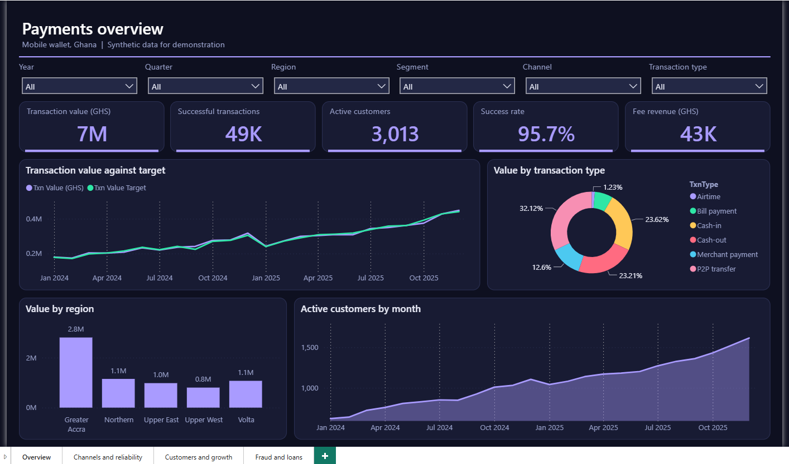
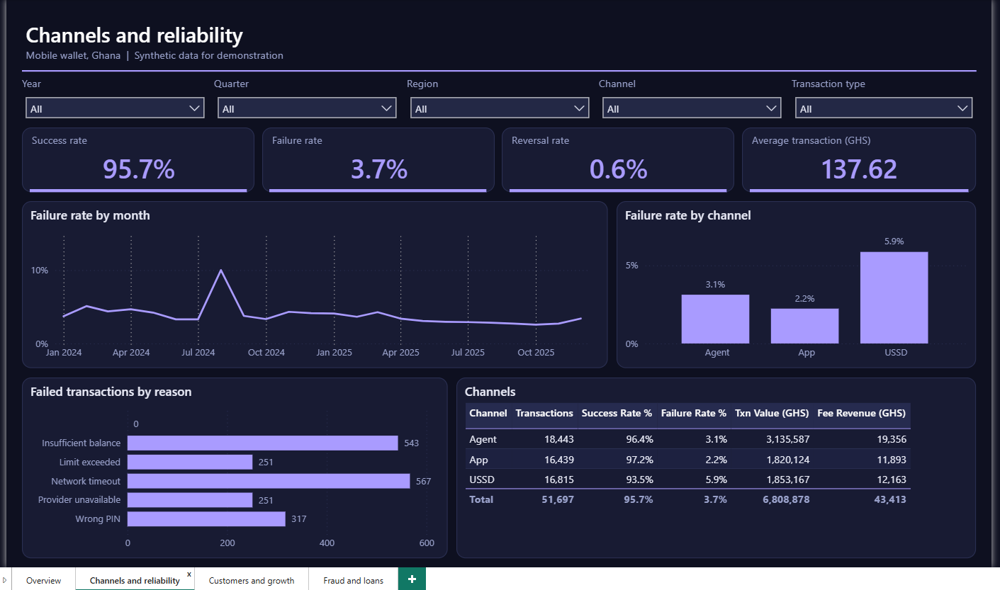
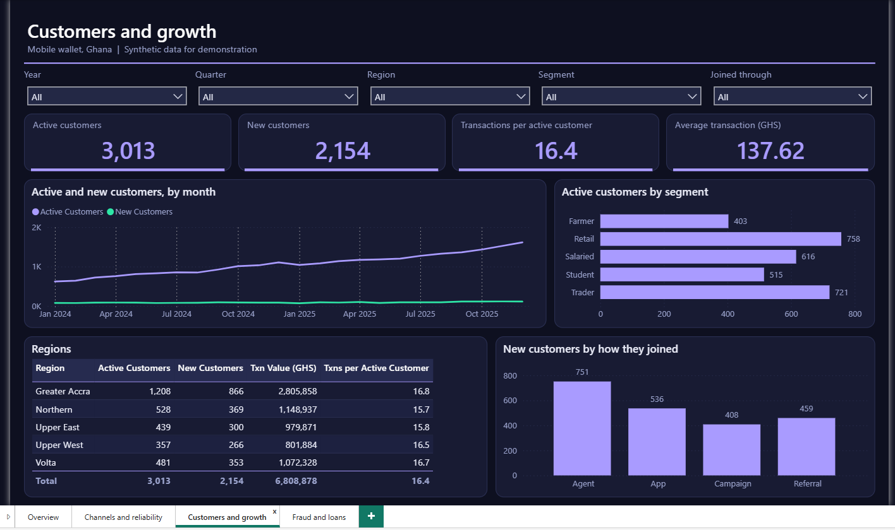
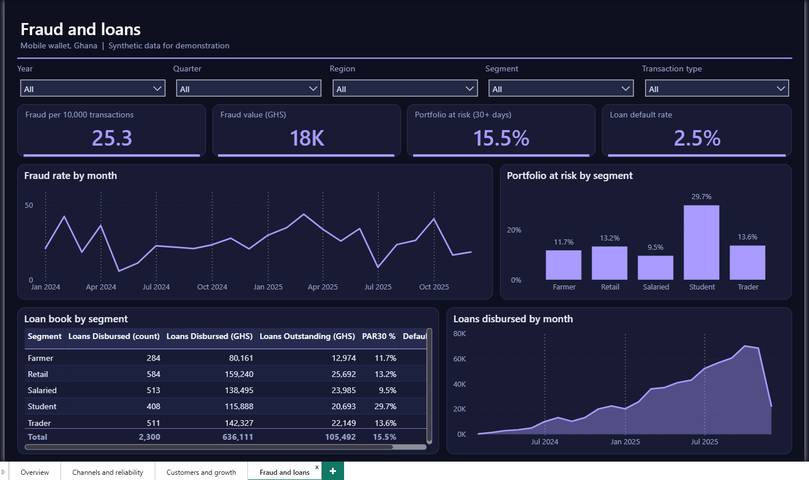

# FinTech Payments (Power BI)

A dashboard for an invented mobile wallet provider: payment volumes, reliability by channel, customer growth, fraud and loan quality. All data is synthetic.

## What it shows

- Transaction value and volume, success and failure rates, and fee revenue, against regional targets
- How reliable the app, USSD and agent channels are, and why transactions fail
- Active and new customers, by region, segment and how they joined
- Fraud rates and the quality of the small-loan book (portfolio at risk and defaults)

## Skills it demonstrates

| Area | Evidence |
| :-- | :-- |
| Power Query | 8 queries: mixed date formats, amounts stored as text, duplicates and inconsistent status text are cleaned; success, failure, fraud and loan-risk flags are calculated; a generated date table (`powerquery/queries.pq`) |
| Data modelling | Star schema with 8 tables and 8 relationships (`docs/model.md`) |
| DAX | 34 measures: success and failure rates, fee revenue, active and new customers, fraud rate, portfolio at risk, default rate, year-on-year, three-month average and `TREATAS` regional targets (`model/measures.dax`) |
| Report design | Four pages, a fixed palette and rules for colour, accessibility and interaction (`docs/report-design.md`) |
| Documentation | Data dictionary, model notes and a user guide for non-technical readers (`docs/`) |

## Contents

- `data/raw/`: 7 CSV files (about 51,697 transactions, 2,300 loans, 3,200 customers, 5 regions)
- `powerquery/queries.pq`, `model/measures.dax`
- `docs/`: `model.md`, `data-dictionary.md`, `report-design.md`, `user-guide.md`
- `pbip/FinTechPayments.pbip`: the Power BI project. See the [main README](../README.md) for how to open it and set the data folder.

## Pictures

### Screenshots from Power BI Desktop

**Payments overview**

**Channels and reliability**

**Customers and growth**

**Fraud and loans**

## Setting and data

The wallet provider, its customers, merchants and loans are invented. Region names are real Ghana regions used only as labels. No real transaction, account or person is included, and nothing here is financial advice.
