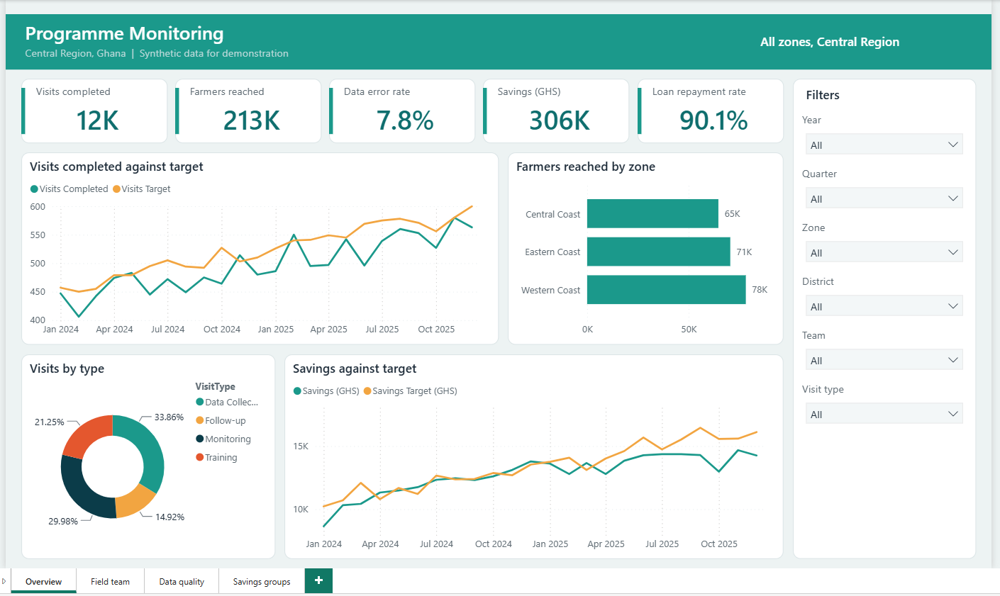
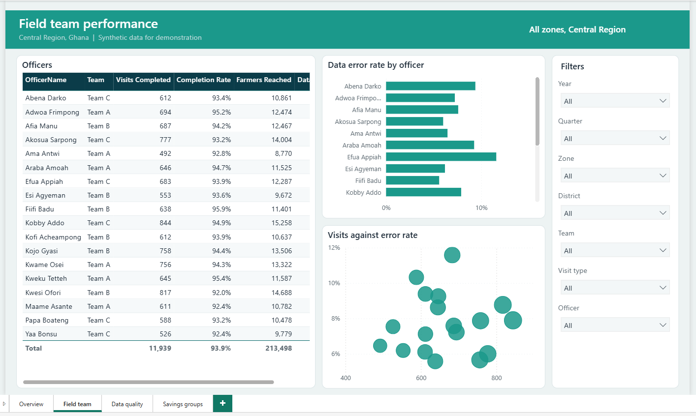
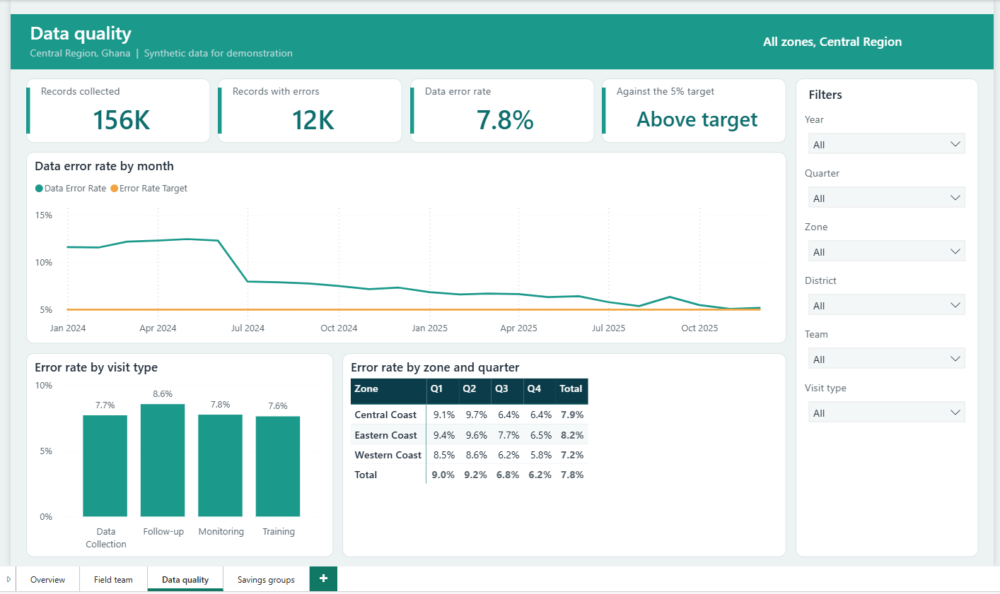
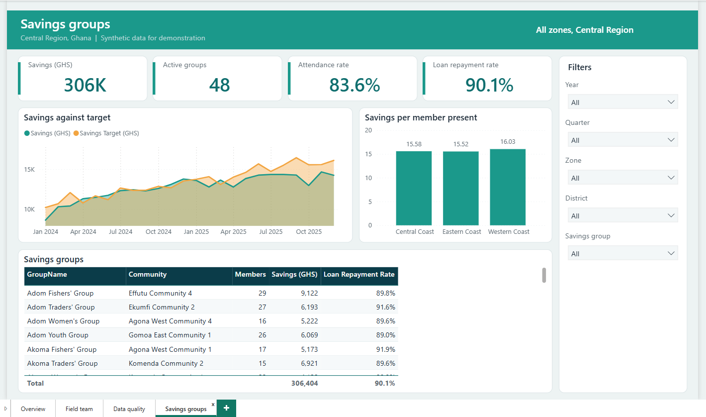

# Programme Monitoring (Power BI)

A dashboard for a field programme in the **Central Region of Ghana**: field visits, data quality and village savings groups. All data is synthetic.

## What it shows

- Whether field teams complete their planned visits and meet monthly targets by zone
- Which officers and visit types produce the most data errors, and whether quality is improving
- How much savings groups save, how well members attend and whether loans are repaid

## Skills it demonstrates

| Area | Evidence |
| :-- | :-- |
| Power Query | Seven cleaning rules for mixed date formats, duplicates, text in number columns and inconsistent text; a generated date table; a parameter for the data folder (`powerquery/queries.pq`) |
| Data modelling | Star schema with two fact areas, a shared date table, a geography chain (zone, district, community) and a target table linked without a many-to-many relationship (`docs/model.md`) |
| DAX | 31 measures: ratios, `CALCULATE` filters, time intelligence (`SAMEPERIODLASTYEAR`, `TOTALYTD`, `DATESINPERIOD`), `TREATAS`, `ISFILTERED` and `RELATED` (`model/measures.dax`) |
| Report design | Four pages, a fixed palette and rules for colour, accessibility and interaction (`docs/report-design.md`) |
| Documentation | Data dictionary, model notes and a user guide for non-technical readers (`docs/`) |

## Contents

- `data/raw/`: 7 CSV files (about 12,800 visits, 1,100 meetings, 48 savings groups, 18 officers, 12 districts)
- `powerquery/queries.pq`, `model/measures.dax`
- `docs/`: `model.md`, `data-dictionary.md`, `report-design.md`, `user-guide.md`
- `pbip/ProgrammeMonitoring.pbip`: Power BI project (4 pages) as saved by Power BI Desktop. See the [main README](../README.md) for how to open it and set the data folder.

## Pictures

### Screenshots from Power BI Desktop

**Overview**

**Field team**

**Data quality**

**Savings groups**

## Setting and data

The Central Region districts used are real district names, used only as labels. The three "zones" (Western Coast, Central Coast, Eastern Coast), the communities, the savings groups and the officers are invented. No real programme data is included.
