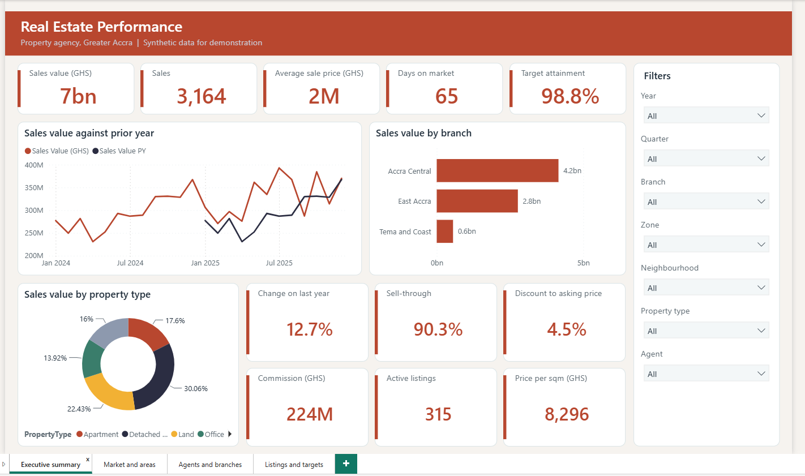
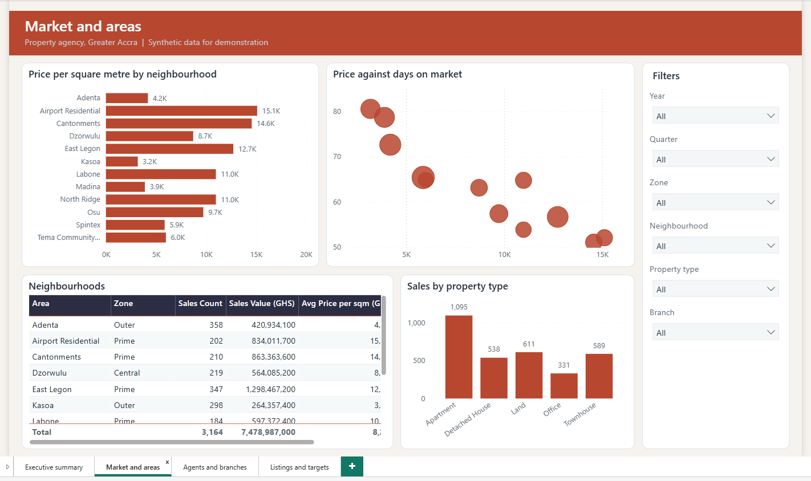
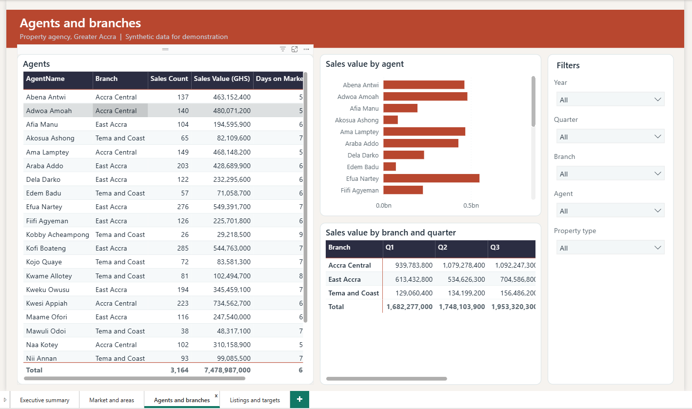
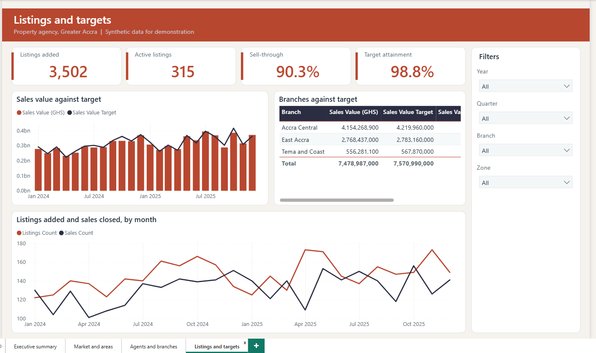

# Real Estate Performance (Power BI)

A dashboard for an invented property agency in Greater Accra: sales, prices, time on the market, agents and progress against branch targets. All data is synthetic.

## What it shows

- Sales value, volume and average price, with change on last year
- Price per square metre and time on the market by neighbourhood and property type
- How agents and branches compare, and whether each branch meets its monthly target
- How many listings are added, sold, still active or withdrawn

## Skills it demonstrates

| Area | Evidence |
| :-- | :-- |
| Power Query | 8 queries: mixed date formats, prices stored as text, duplicates and inconsistent text are cleaned; days on market and commission are calculated; a generated date table (`powerquery/queries.pq`) |
| Data modelling | Star schema with 8 tables and 9 relationships (`docs/model.md`) |
| DAX | 28 measures: sales value, price per square metre, days on market, discount to list, sell-through, year-on-year, year-to-date, three-month average and `TREATAS` branch targets (`model/measures.dax`) |
| Report design | Four pages, a fixed palette and rules for colour, accessibility and interaction (`docs/report-design.md`) |
| Documentation | Data dictionary, model notes and a user guide for non-technical readers (`docs/`) |

## Contents

- `data/raw/`: 7 CSV files (about 3,164 sales, 3,502 listings, 3,763 properties, 24 agents, 12 neighbourhoods)
- `powerquery/queries.pq`, `model/measures.dax`
- `docs/`: `model.md`, `data-dictionary.md`, `report-design.md`, `user-guide.md`
- `pbip/RealEstatePerformance.pbip`: the Power BI project. See the [main README](../README.md) for how to open it and set the data folder.

## Pictures

### Screenshots from Power BI Desktop

**Executive summary**

**Market and areas**

**Agents and branches**

**Listings and targets**

## Setting and data

The agency, its branches, agents and every property are invented. Neighbourhood names are real Greater Accra locations used only as labels. Prices are illustrative and are not market data. No real transaction is included.
