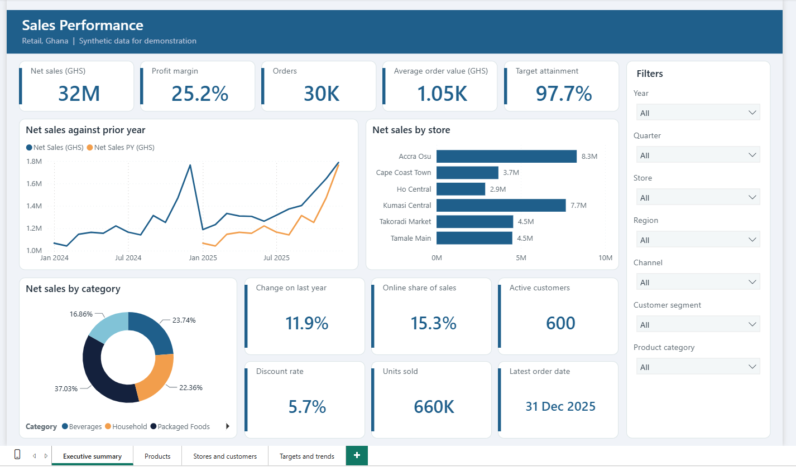
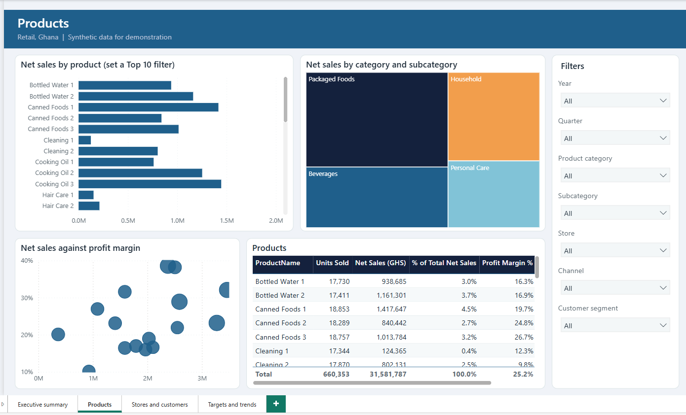
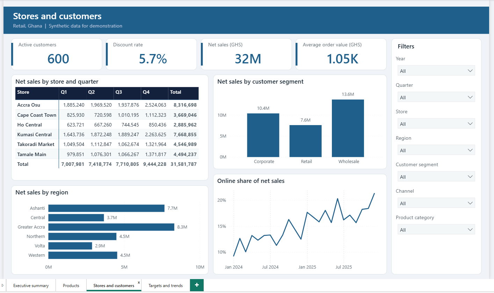
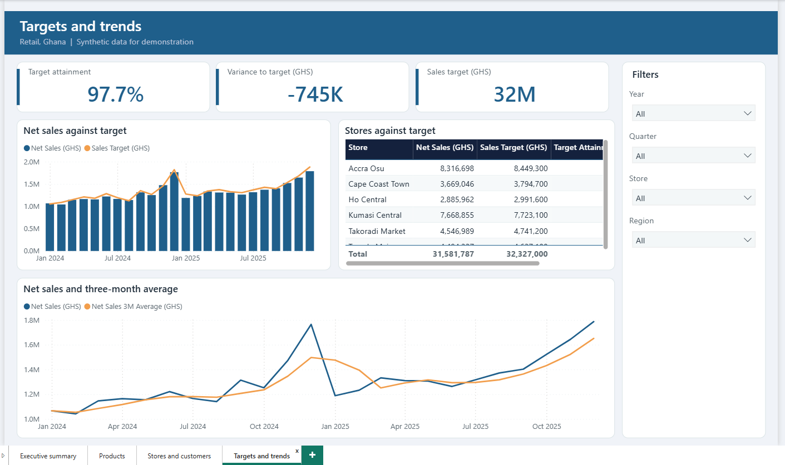

# Sales Performance (Power BI)

A dashboard for an invented retail business with six stores in Ghana: sales, profit, products, customers and progress against monthly targets. All data is synthetic.

## What it shows

- Net sales, profit margin and orders, with change on the same period last year
- Which products, categories, stores and customer segments drive sales and margin
- How fast online sales are growing
- Whether each store meets its monthly target

## Skills it demonstrates

| Area | Evidence |
| :-- | :-- |
| Power Query | Cleaning rules for mixed date formats, discounts stored as text ("5%"), inconsistent product codes, duplicates and inconsistent text; calculated line amounts; a generated date table (`powerquery/queries.pq`) |
| Data modelling | Classic star schema (one fact table at order-line grain, one target table, four dimensions), with a deliberate decision not to relate customer home store (`docs/model.md`) |
| DAX | 27 measures: margin, share of total, year-on-year, year-to-date, previous year to date, month-on-month, three-month average, `RANKX`, `TOPN` and `TREATAS` targets (`model/measures.dax`) |
| Report design | Four pages, a fixed palette and rules for colour, accessibility and interaction (`docs/report-design.md`) |
| Documentation | Data dictionary, model notes and a user guide for non-technical readers (`docs/`) |

## Contents

- `data/raw/`: 5 CSV files (about 75,000 order lines, 600 customers, 36 products, 6 stores)
- `powerquery/queries.pq`, `model/measures.dax`
- `docs/`: `model.md`, `data-dictionary.md`, `report-design.md`, `user-guide.md`
- `pbip/SalesPerformance.pbip`: Power BI project (4 pages) as saved by Power BI Desktop. See the [main README](../README.md) for how to open it and set the data folder.

## Pictures

### Screenshots from Power BI Desktop

**Executive summary**

**Products**

**Stores and customers**

**Targets and trends**

## Setting and data

The business, its products and customers are invented. The store towns are real Ghana towns, used only as labels. No real sales data is included.
