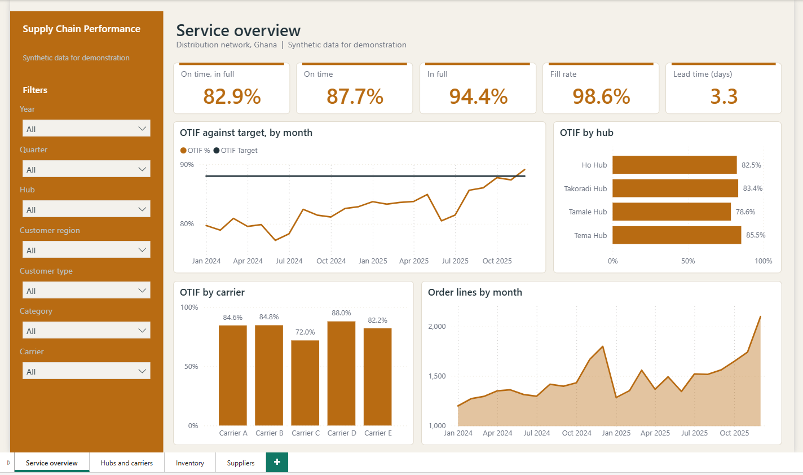
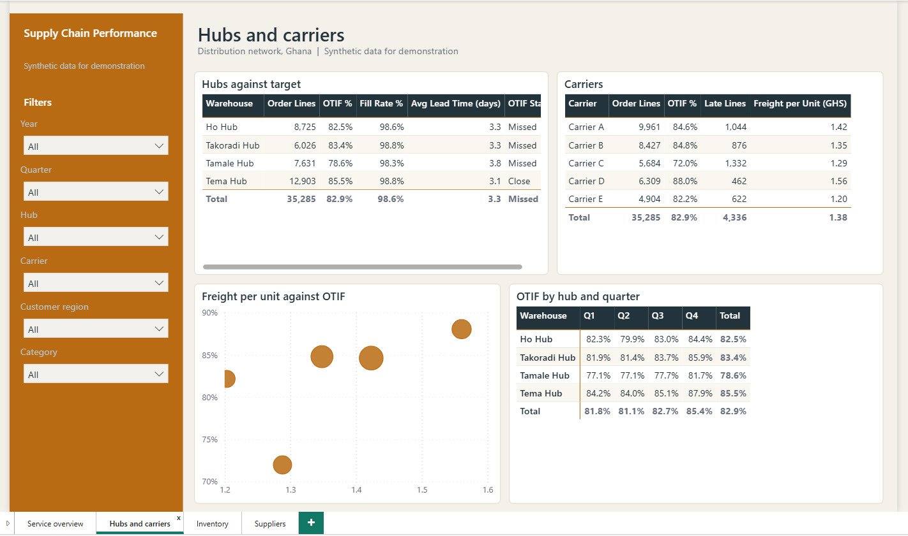
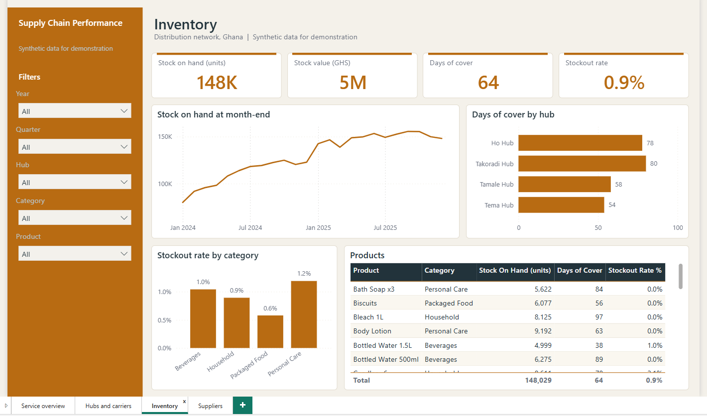
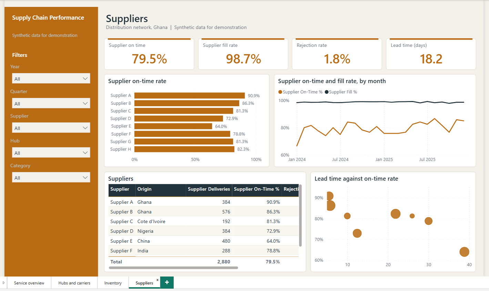

# Supply Chain Performance (Power BI)

A dashboard for an invented distributor serving retailers from four hubs: delivery performance, stock and supplier reliability. All data is synthetic.

## What it shows

- Whether orders arrive on time and in full (OTIF), against an 88% target, by hub, carrier and customer region
- Fill rate, lead time and freight cost per unit
- Stock on hand, stock value, days of cover and stockouts by hub and product
- How reliably suppliers deliver, how much they ship in full, and how much is rejected

## Skills it demonstrates

| Area | Evidence |
| :-- | :-- |
| Power Query | 10 queries: mixed date formats, text in cost columns, duplicates and inconsistent text are cleaned; on-time, in-full, lead time and stockout flags are calculated; a generated date table (`powerquery/queries.pq`) |
| Data modelling | Star schema with 10 tables and 13 relationships (`docs/model.md`) |
| DAX | 35 measures: OTIF, fill rate, lead time, freight per unit, supplier performance, latest-snapshot stock measures, days of cover, year-on-year, three-month average and `TREATAS` targets (`model/measures.dax`) |
| Report design | Four pages, a fixed palette and rules for colour, accessibility and interaction (`docs/report-design.md`) |
| Documentation | Data dictionary, model notes and a user guide for non-technical readers (`docs/`) |

## Contents

- `data/raw/`: 9 CSV files (about 35,285 order lines, 2,880 stock counts, 2,880 supplier receipts, 80 customers, 30 products, 4 hubs)
- `powerquery/queries.pq`, `model/measures.dax`
- `docs/`: `model.md`, `data-dictionary.md`, `report-design.md`, `user-guide.md`
- `pbip/SupplyChainPerformance.pbip`: the Power BI project. See the [main README](../README.md) for how to open it and set the data folder.

## Pictures

### Screenshots from Power BI Desktop

**Service overview**

**Hubs and carriers**

**Inventory**

**Suppliers**

## Setting and data

The distributor, its customers, products, suppliers and carriers are invented. Hub town names are real Ghana towns used only as labels. No real company, shipment or inventory record is included.
